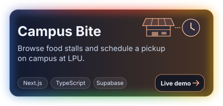

  

  

  

  
  
  
  
  

  

---

## ⚡ Tech stack

  

---

## About me

I’m a B.Tech computer science student from Uttar Pradesh, India, studying AI and machine learning. I build projects that connect the interface to what happens behind it, from finding the right source for an AI answer to keeping a kitchen’s order queue up to date.

## 🚀 Selected work

  
  
  
  

  
Project source code

  - [Memory AI](https://github.com/aayushtyagi00/memory-ai)
  - [ResQRoute](https://github.com/aayushtyagi00/resqroute-emergency-escape-planner)
  - [Campus Bite](https://github.com/aayushtyagi00/Campusbite)
  - [Aurel Hotels](https://github.com/aayushtyagi00/Aurel-Hotels-project)

## 📊 GitHub activity

  
  

  

### 🐍 Contribution snake

<picture>
  <source media="(prefers-color-scheme: dark)" srcset="./assets/github-snake-dark.svg" />
  
</picture>

  

