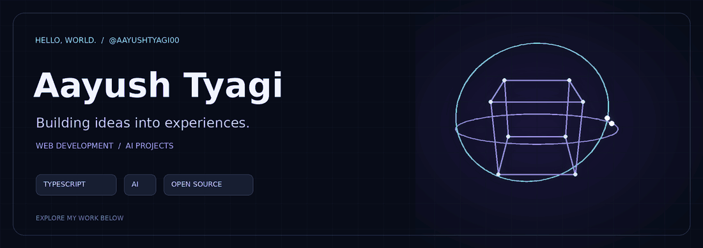

  

  <a href="https://github.com/aayushtyagi00/aayush-tyagi-portfolio">Portfolio Project</a> &nbsp;·&nbsp;
  <a href="mailto:tyagiaayush3030@gmail.com">Email</a> &nbsp;·&nbsp;
  <a href="https://github.com/aayushtyagi00?tab=repositories">All Repositories</a>

### A little about me

I'm Aayush, a developer from Uttar Pradesh, India. My projects explore web applications, AI assistants, and tools for real-world problems.

### Selected work

| Project | What it's about |
| :--- | :--- |
| [ResQRoute](https://github.com/aayushtyagi00/resqroute-emergency-escape-planner) | AI-powered emergency escape and evacuation planning |
| [Memory AI](https://github.com/aayushtyagi00/memory-ai) | A personal memory assistant using Gemini and grounded retrieval |
| [Spice Tree](https://github.com/aayushtyagi00/spice-tree) | A restaurant application with kitchen tracking and reservations |
| [3D Portfolio](https://github.com/aayushtyagi00/aayush-tyagi-portfolio) | My cinematic 3D portfolio project |

---

Ideas → code → experiences.

