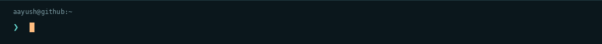

  

  

  <a href="https://new.aayushtyagi.live">Portfolio</a> &nbsp;·&nbsp;
  <a href="mailto:tyagiaayush3030@gmail.com">Email</a> &nbsp;·&nbsp;
  <a href="https://github.com/aayushtyagi00?tab=repositories">All Repositories</a>

### `whoami`

I'm **Aayush Tyagi**, a student from Uttar Pradesh, India, learning software development by turning ideas into real projects. I'm interested in web applications, AI-powered tools, and understanding how things work behind the scenes.

From an AI memory assistant to an emergency escape planner, my projects are how I experiment, solve problems, and put what I learn into practice. I'm still learning—and every project is a chance to build something better.

### 🛠️ Tech Stack

Tools and technologies I'm learning and exploring through projects.

  
   
  

### `selected_work`

| Project | What it's about |
| :--- | :--- |
| [ResQRoute](https://github.com/aayushtyagi00/resqroute-emergency-escape-planner) | AI-powered emergency escape and evacuation planning |
| [Memory AI](https://github.com/aayushtyagi00/memory-ai) | A personal memory assistant using Gemini and grounded retrieval |
| [Spice Tree](https://github.com/aayushtyagi00/spice-tree) | A restaurant application with kitchen tracking and reservations |
| [Portfolio](https://new.aayushtyagi.live) | My projects, experiments, and learning journey in one place |

---

### `github_stats`

  
  

  

Updated daily from public GitHub data. Streaks use the displayed contribution calendar; languages measure code bytes in my own public repositories.

---

### `contribution_snake`

  

---

Designed by curiosity. Built through experimentation.

