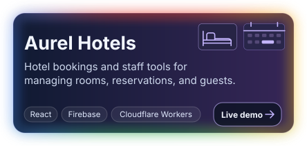
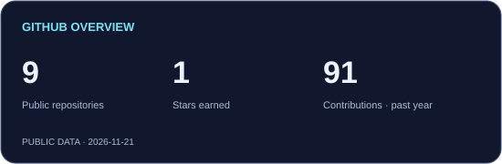
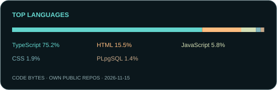

  

<h1 align="center">Hi, I’m Aayush Tyagi</h1>

  <strong>Computer science student building web apps and AI tools</strong>

  <a href="https://new.aayushtyagi.live">Portfolio</a> ·
  <a href="https://www.linkedin.com/in/aayushtyagi00/">LinkedIn</a> ·
  <a href="mailto:tyagiaayush3030@gmail.com">Email</a> ·
  <a href="https://github.com/aayushtyagi00?tab=repositories">Repositories</a>

  

## About me

I’m a B.Tech computer science student from Uttar Pradesh, India, studying AI and machine learning. I build projects that connect the interface to what happens behind it, from finding the right source for an AI answer to keeping a kitchen’s order queue up to date.

## 🚀 Selected work

<table width="100%">
  <tr>
    <td width="50%" valign="top">
      
      <h3>Memory AI</h3>
      
Save documents and notes, search them, and ask questions that link back to the original sources.

      
<code>Gemini</code> <code>Supabase</code>

      <a href="https://memory-ai-two-eta.vercel.app"><strong>Live demo</strong></a> ·
      <a href="https://github.com/aayushtyagi00/memory-ai">Source code</a>
    </td>
    <td width="50%" valign="top">
      
      <h3>ResQRoute</h3>
      
An evacuation-planning prototype that combines interactive maps, route alternatives, and an AI planning assistant.

      
<code>React</code> <code>Leaflet</code> <code>Gemini</code>

      <a href="https://resqroute-jgo0.onrender.com"><strong>Live demo</strong></a> ·
      <a href="https://github.com/aayushtyagi00/resqroute-emergency-escape-planner">Source code</a>
    </td>
  </tr>
  <tr>
    <td width="50%" valign="top">
      
      <h3>Spice Tree</h3>
      
Restaurant ordering and table reservations with live order tracking and a dashboard for the kitchen.

      
<code>React</code> <code>TypeScript</code> <code>Firebase</code>

      <a href="https://spicetree-restaurant.web.app"><strong>Live demo</strong></a> ·
      <a href="https://github.com/aayushtyagi00/spice-tree">Source code</a>
    </td>
    <td width="50%" valign="top">
      
      <h3>Aurel Hotels</h3>
      
A hotel booking site with staff tools for tracking room readiness, reservations, and guest details.

      
<code>React</code> <code>Firebase</code> <code>Cloudflare Workers</code>

      <a href="https://aurel-hotels.web.app"><strong>Live demo</strong></a> ·
      <a href="https://github.com/aayushtyagi00/Aurel-Hotels-project">Source code</a>
    </td>
  </tr>
</table>

## ⚡ Tech stack

  

- **Frontend** · React, TypeScript, Vite, Tailwind CSS
- **Data and deployment** · Supabase, Firebase, Cloudflare Workers, Vercel
- **AI and maps** · Google Gemini, document retrieval, Leaflet
- **Version control** · Git and GitHub

## 📊 GitHub activity

  
  

  

### 🐍 Contribution snake

<picture>
  <source media="(prefers-color-scheme: dark)" srcset="./assets/github-snake-dark.svg" />
  
</picture>

  

